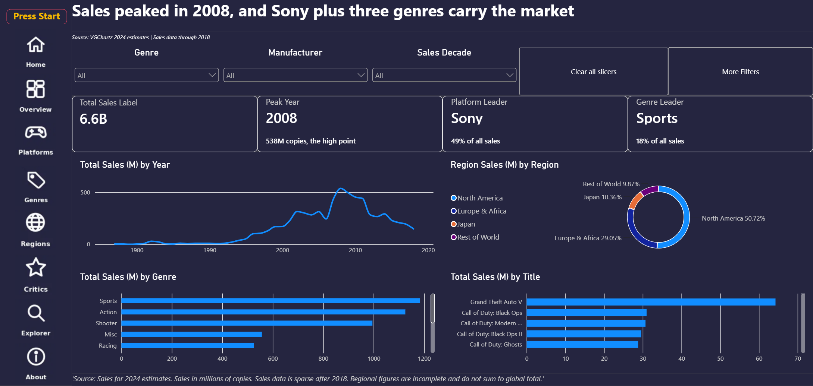

# Video Game Sales Dashboard (Power BI)

An interactive, 8-page Power BI dashboard that explores 6.6 billion copies of video games sold, built from the VGChartz 2024 dataset. It answers one question: **what drives video game sales, and where is the market now?**

## Key insights

- **6.6B copies** sold in total (titles with sales data only).
- **Release-year peak: 2008** (about 538M copies), then a steady decline. Titles released in the 2000s account for roughly **half** of all sales.
- **Sony leads platforms** with about 49% of sales (3.26B), ahead of Nintendo (25%) and Microsoft (21%). The PlayStation 2 is the top single console (about 1.03B).
- **Three genres make up about half of sales:** Sports (1.18B), Action (1.13B) and Shooter (1.00B).
- **Publishers:** Activision (723M) and Electronic Arts (644M, about 1.13B combined with EA Sports) lead. Grand Theft Auto V is the best-selling title (64.3M).
- **Critic scores help, but only a little:** correlation with sales is about 0.28. Games scoring 8 or higher average 1.31M copies versus 0.47M for the rest.
- **The market is top-heavy:** the median title sells about 0.12M copies, against a mean of 0.35M.

## Dashboard pages

| Page | What it shows |
|---|---|
| Home | Landing page and navigation |
| Overview | Headline KPIs, sales by release year, region split, top genres and games |
| Platforms | Sales by console and manufacturer |
| Genres | Genre and publisher performance |
| Regions | North America, Europe and Africa, Japan, Rest of World |
| Critics | Critic score versus sales |
| Explorer | Searchable table with drill-through to a single game |
| About | Purpose, data source and limitations |

*(Add screenshots: `screenshots/platforms.png`, `genres.png`, `regions.png`, `critics.png`, `explorer.png`.)*

## How to open it

1. Download `VG_Sales_Capstone.pbix` (open the file, then click **Download raw file**).
2. Open it in **Power BI Desktop** (Windows).
3. Use the left navigation bar. In Desktop, **Ctrl + click** buttons to follow them.

## Data source

VGChartz 2024 video game sales estimates (`vgchartz-2024.csv`) with its data dictionary. The data is not included in this repository; please obtain it from the original source. `assets/console_map.csv` is a small lookup table (console to manufacturer) created for this project.

## Method

- **Power Query:** removed duplicate titles (64,016 to 63,894 rows), added release year, sales decade and a console-to-manufacturer map, replaced missing developer names with "Unknown", and unpivoted regional sales into a long table. Sales and critic-score blanks were deliberately left blank (no data is not zero).
- **Data model:** Games to Console_Map (many-to-one) and Games to Region_Sales (one-to-many).
- **DAX:** measures for total sales, peak year, top manufacturer, top genre, shares and labels.
- **Design:** custom dark theme (`assets/gaming_theme.json`), page navigator, sync slicers, drill-through, bookmarks.

## Limitations

- Only about 30% of titles (18,880) have sales figures.
- Sales data is sparse after 2018, so the peak and decline reflect data coverage as well as the market.
- Regional columns are incomplete and do not add up exactly to the global total (6,593.6M vs 6,598.1M).
- Only about 10% of titles have a critic score.

## Author

**[Your Name]** | [Course] | [Date]
[LinkedIn or email]

## Tools

Power BI Desktop, Power Query, DAX
